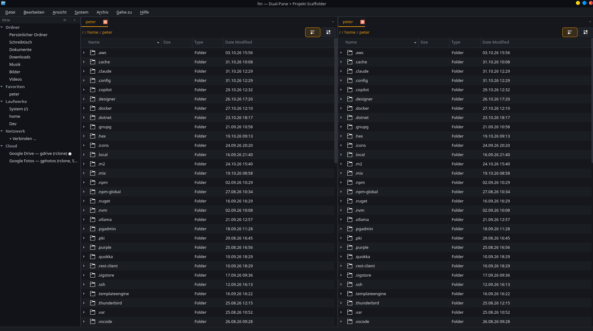
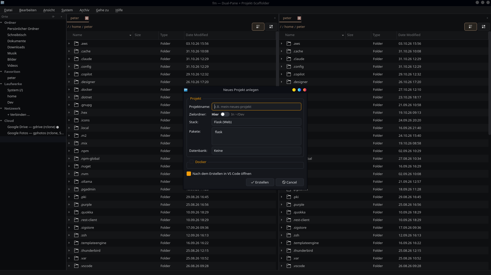

# fm

Ein Dual-Pane-Dateimanager für Linux (PySide6/Qt), mit eingebettetem Terminal,
Archiv-Unterstützung und einem Projekt-Generator für neue Entwicklungsprojekte.

## Screenshots



Was im Screenshot zu sehen ist:

| # | Bereich | Beschreibung |
|---|---|---|
| 1 | Menüleiste | Datei, Bearbeiten, Ansicht, System, Archiv, Gehe zu, Hilfe |
| 2 | Orte-Leiste | Links andockbar (Strg+B): Ordner, Favoriten, Laufwerke, Netzwerk, Cloud — Klick navigiert das aktive Pane dorthin |
| 3 | Tabs | Pro Pane mehrere Orte offen (Strg+T neu, Strg+W schließen) |
| 4 | Breadcrumb | Aktueller Pfad, Strg+L zum direkten Eingeben |
| 5 | Dual-Pane-Ansicht | Zwei unabhängige Dateilisten nebeneinander, mit passenden Dateityp-Icons |
| 6 | Terminal-Panel | Eingebettetes echtes Terminal unten (F4), „→ aktueller Ordner“ springt dorthin |
| 7 | Statusleiste | Auswahl/Pfad des zuletzt aktiven Panes |



## Funktionen

**Dateiverwaltung**
- Zwei unabhängige Panes nebeneinander, mit Tabs pro Pane
- Listen- und Kachelansicht, Breadcrumb-Pfadleiste (Strg+L zum direkten Eingeben)
- Kopieren, Ausschneiden, Einfügen, Umbenennen, Löschen in den Papierkorb (freedesktop-konform)
- Drag & Drop zwischen Panes und in Unterordner, Strg beim Ziehen kopiert
- Neue Ordner, Vorschau (Bilder, PDF, Text, Office-Dateien) per F3
- Rechte & Eigentümer (chmod/chown) mit Oktal-Eingabe, optional rekursiv
- Passende Icons je Dateityp (Word, Excel, Python, JavaScript, Archive, …)
- Bildvorschau als Thumbnail direkt in der Ansicht

**Suche**
- Dateiname als Teiltext oder Glob (z. B. `*.py`)
- Optional Volltextsuche in Textdateien bis 5 MB
- Läuft im Hintergrund, abbrechbar

**Archive**
- Doppelklick auf ein Archiv öffnet die Inhaltsansicht
- Entpacken „hier“ oder „nach …“, einzelne Einträge oder alles
- Packen zu ZIP, TAR.GZ, TAR.BZ2 oder TAR.XZ
- Unterstützt: `.zip`, `.tar`, `.tar.gz`/`.tgz`, `.tar.bz2`/`.tbz2`, `.tar.xz`/`.txz`
  (7z und RAR werden nicht unterstützt)

**Terminal**
- Eingebettetes, echtes Terminal unten im Fenster (F4), Shell aus `$SHELL`
- Farben, Cursor-Steuerung und Vollbild-Programme wie `vim`, `htop`, `less` funktionieren
- Mausrad scrollt durch den Verlauf, Knopf „→ aktueller Ordner“ wechselt in den Ordner des aktiven Panes

**Orte-Leiste** (Strg+B ein-/ausblenden)
- **Ordner** — Home + die über `xdg-user-dirs` konfigurierten Standardordner
  (Schreibtisch, Dokumente, Downloads, Musik, Bilder, Videos)
- **Favoriten** — eigene Lesezeichen, Strg+D merkt den aktuellen Ordner,
  Rechtsklick entfernt einen Eintrag, gespeichert in `~/.config/fm/bookmarks.json`
- **Laufwerke** — gemountete Partitionen/Wechseldatenträger, Rechtsklick „Aushängen“
- **Netzwerk** — SMB/FTP/SFTP/WebDAV/NFS verbinden (über `gio`/GVFS), aktive
  Freigaben erscheinen automatisch, Rechtsklick „Trennen“
- **Cloud** — Google Drive als Live-Mount über rclone (dauerhafter
  systemd-Dienst), Google Fotos als täglicher Hintergrund-Sync nach
  `~/Bilder/Google Fotos`. Erfordert ein eingerichtetes rclone-Remote
  (`rclone config`)

**System-Manager** (F6, eigenständiges Fenster)
- **Prozesse** — Live-Tabelle (PID, Name, Nutzer, CPU %, RAM, Befehl), Filter,
  Rechtsklick zum Beenden (SIGTERM) oder Erzwingen (SIGKILL)
- **Ressourcen** — CPU gesamt + pro Kern mit Verlaufsgrafik, RAM/Swap,
  Netzwerk- und Datenträger-Durchsatz, aktualisiert sich laufend

**Projekt-Generator (F7)**
- Python: Flask, FastAPI, Django, CLI-Tool (Click), Paket/Library, Data
  Science (Jupyter) — jedes mit echtem venv + pip install
- Node, React (Vite), Vue (Vite), Angular — über die offiziellen CLI-Generatoren
- Java (Maven), Java (Gradle), Phoenix (Elixir)
- .NET Web API, .NET Razor Pages, .NET MVC
- Optional Datenbank-Anbindung (SQLite, PostgreSQL, MySQL, SQL Server) und
  Docker-Grundgerüst (Dockerfile, docker-compose, .env)

## Voraussetzungen

- Linux (getestet mit KDE Plasma unter Wayland)
- Python 3 (getestet mit 3.14)
- Optional, je nach Funktion:
  - **git** für das automatische Update (`fm-update`)
  - **LibreOffice** (`soffice`) für die Vorschau von Office-Dateien
  - **Node.js + npm/npx** für die Node-, React-, Vue- und Angular-Vorlagen
  - **.NET SDK** für die .NET-Vorlagen
  - **Maven**/**Gradle** zum Bauen der Java-Vorlagen (fm legt die Projekte
    auch ohne an, gebraucht werden sie erst beim Kompilieren)
  - **Elixir/mix** mit installiertem `phx_new`-Archiv für die Phoenix-Vorlage
  - **rclone** für Google Drive/Fotos in der Orte-Leiste
  - **gio**/**GVFS**, **udisksctl** für Netzwerkfreigaben bzw. Laufwerke
    aushängen (auf den meisten Desktop-Linux-Systemen schon vorhanden)

## Installation

```bash
git clone https://github.com/peter1965p/fm.git
cd fm
./install.sh
```

`install.sh` (als normaler Nutzer, **nicht** mit `sudo`) legt das venv an,
installiert die Abhängigkeiten, richtet einen Menüeintrag ein, verlinkt
`fm` nach `~/.local/bin`, fragt ob fm zum Standard-Dateimanager werden soll
und aktiviert einen täglichen `systemd --user`-Timer, der automatisch
`git pull` im Repo macht (`fm-update`). Alles rückgängig machen:
`./uninstall.sh` (lässt Repo und venv unangetastet).

Manuell, ohne die Skripte:

```bash
python3 -m venv venv
venv/bin/pip install -r requirements.txt
```

## Starten

```bash
./fm                 # öffnet im Home-Verzeichnis
./fm /pfad/zum/ordner
```

Nach `install.sh` reicht auch einfach `fm` (im PATH) oder der Eintrag im
Anwendungsmenü. Alternativ direkt mit Python:

```bash
venv/bin/python3 fm.py [Startpfad]
```

## Tastenkürzel

| Taste | Aktion |
|---|---|
| Tab | Aktives Pane wechseln |
| Strg+L | Pfad eingeben |
| Backspace | Eine Ebene nach oben |
| F3 | Vorschau |
| F2 | Umbenennen |
| F4 | Terminal ein-/ausblenden |
| F5 | Aktualisieren |
| F7 | Neues Projekt |
| Entf | In den Papierkorb |
| Strg+C / Strg+X / Strg+V | Kopieren / Ausschneiden / Einfügen |
| Strg+F | Suchen |
| Strg+T | Neuer Tab |
| Strg+W | Tab schließen |
| Strg+Tab / Strg+Umschalt+Tab | Nächster / vorheriger Tab |
| Strg+B | Orte-Leiste ein-/ausblenden |
| Strg+D | Aktuellen Ordner zu Favoriten hinzufügen |
| F6 | System-Manager öffnen |
| Strg+Q | Beenden |

Im Terminal werden alle Tastenkürzel an die Shell weitergegeben, außer F4 (Terminal ausblenden).

## Projektstruktur

```
fm.py              Die gesamte Anwendung
fm                 Startskript
fm-update           Vom Auto-Update-Timer aufgerufen: git pull + pip install
install.sh          Richtet fm ein (venv, Menüeintrag, PATH, Auto-Update-Timer)
uninstall.sh         Macht install.sh rückgängig (Repo/venv bleiben erhalten)
requirements.txt    Python-Abhängigkeiten (PySide6, pyte, psutil)
assets/             Screenshots fürs README
```

## Lizenz

GNU General Public License v3.0 oder neuer — siehe [LICENSE](LICENSE).
Du darfst fm frei nutzen, verändern und weitergeben, solange abgeleitete Versionen
unter derselben Lizenz bleiben.
